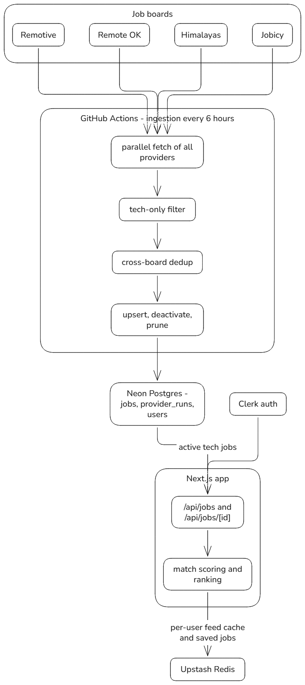

# Worksy

A job discovery app for early-career tech roles: a ranked feed of remote
software jobs open to candidates in India, personalized to each user's skills,
target roles, and experience level.

## What it does

- **Tech-only listings.** Jobs come from four remote job boards — Remotive,
  Remote OK, Himalayas, and Jobicy — but only tech roles make it into the app.
  Non-tech listings (nursing, sales, legal, …) are filtered out at ingestion
  time, never at request time.
- **Personalized ranking.** Every job is scored against the signed-in user's
  profile — skills, desired roles, experience level, work mode, job type — and
  the feed is sorted by match score with human-readable match reasons.
- **Search and filters.** Full-text search over title/company/description,
  job-type and work-mode filters, and stable pagination.
- **Save for later.** Per-user saved jobs (kept in Redis for 30 days) with a
  bookmarks page to revisit and apply from.
- **Always fresh.** The job corpus is refreshed daily by a scheduled pipeline,
  so user requests never hit the job board APIs and the feed reflects the
  latest successful ingest.

## Architecture

**1. Ingestion — scheduled pipeline on GitHub Actions (runs daily)**

`scripts/ingest-jobs.ts` fetches all four job boards in parallel — every
provider is fetched on every run, so one slow or failing provider can never
starve the others. A tech-only classifier (`lib/tech-classifier.ts`) drops
non-tech titles, the same job listed on multiple boards is deduplicated by
normalized title, company, and location, and the result is upserted into the
`jobs` table in Postgres. Listings that vanished from every feed are
deactivated (only when every provider answered, so an outage never marks live
jobs dead), rows inactive for 45 days are pruned, and each run records
per-provider health in `provider_runs`, which the API surfaces as source
status. The pipeline is idempotent: re-running against the same data changes
nothing.

**2. Serving — Next.js App Router**

`/api/jobs` and `/api/jobs/[id]` read only from the database. Building a feed
means reading active rows, keeping India-eligible remote jobs, scoring each
job against the user's profile with a rule-based matcher (`lib/matching.ts`),
and sorting by match score, then posting date. The ranked feed is cached per
user in Upstash Redis for 15 minutes so paging stays stable and repeat
requests stay fast; the cache is invalidated whenever the user's profile
changes. Saved jobs also live in Redis. Clerk handles authentication.

**Storage.** Neon Postgres holds the job corpus, users, and profiles
(accessed through Prisma). Upstash Redis holds the per-user feed cache and
saved jobs.

Job ids such as `remotive-123` are stable forever: the ingestion pipeline
never rewrites them once written, so saved jobs and detail-page links keep
working across runs.

## Tech stack

| Layer              | Choice                                      |
| ------------------ | ------------------------------------------- |
| Framework          | Next.js (App Router, route handlers)        |
| Language           | TypeScript                                  |
| Styling            | Tailwind CSS + shadcn/ui components         |
| Auth               | Clerk                                       |
| Database           | Neon Postgres via Prisma                    |
| Cache & saved jobs | Upstash Redis                               |
| Scheduling         | GitHub Actions cron (free on a public repo) |

## Documentation

- [`knowledge/ingestion.md`](knowledge/ingestion.md) — the ingestion pipeline, provider notes, and the checklist for adding a new job board
- [`knowledge/jobs-api.md`](knowledge/jobs-api.md) — the `/api/jobs` and `/api/jobs/[id]` response contract
- [`knowledge/completed-work.md`](knowledge/completed-work.md) — full feature inventory and implementation notes
