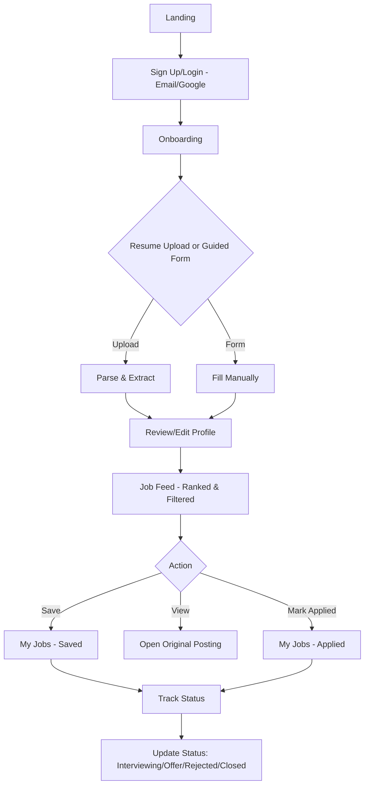

# Bengaluru Fresher Jobs - Implementation Plan

**Version:** 1.0
**Date:** 2026-10-28
**Target:** MVP for helping Bengaluru freshers find and track relevant jobs in < 5 minutes

## Table of Contents
- [Goals & Success Metrics](#goals--success-metrics)
- [User Flow](#user-flow)
- [Data Model](#data-model)
- [Feature Breakdown](#feature-breakdown)
- [Job Sources](#job-sources)
- [Matching Algorithm](#matching-algorithm)
- [Technical Architecture](#technical-architecture)
- [Implementation Phases](#implementation-phases)
- [Risks & Mitigations](#risks--mitigations)

## Goals & Success Metrics

### Primary Goal
Help a Bengaluru fresher go from resume/profile to a shortlist of relevant jobs in under 5 minutes.

### Success Metrics
| Metric | Target | Measurement |
|---|---|---|
| % of new users who complete onboarding | > 60% | Track profile completion |
| % who see at least 10 relevant jobs | > 40% | Jobs shown after matching |
| % who open a job posting | > 30% | Click tracking on apply link |
| % who save a job | > 25% | Save action |
| % who mark a job as applied | > 15% | Status change to Applied |
| Repeat usage within 7 days | > 20% | Return visits |

### Additional Metrics (Recommended)
| Metric | Target | Measurement |
|---|---|---|
| Time to first relevant job view | < 5 min | From signup to first job card click/view |
| Profile completion rate (minimum fields) | > 70% | Using minimal required fields only |
| Saved → Applied conversion | > 40% | Of saved jobs, how many become applied |

## User Flow



## Data Model

### User
```typescript
User {
  id: UUID (primary key)
  email: string (unique)
  name: string
  auth_provider: 'email' | 'google'
  created_at: timestamp
  updated_at: timestamp
}
```

### Profile
```typescript
Profile {
  id: UUID (primary key)
  user_id: UUID (FK -> User)
  // Education
  degree: string
  major: string
  graduation_year: number
  college: string
  // Skills
  skills: string[] // normalized to lowercase
  // Projects
  projects: Project[] // {name, description, tech_stack: string[]}
  // Preferences
  preferred_roles: string[]
  location_preference: 'Bengaluru' | 'Bangalore' | 'Remote' | 'Hybrid'
  salary_min: number | null
  salary_max: number | null
  company_type_preference: ('Startup' | 'MNC' | 'Service' | 'Any')[]
  industry_preference: string[]
  job_type_preference: ('Full-time' | 'Internship' | 'Contract')[]
  availability: 'Immediate' | '15 days' | '30 days' | 'Notice Period'
  // Metadata
  resume_url: string | null
  resume_parsed_at: timestamp | null
  onboarding_completed: boolean
  created_at: timestamp
  updated_at: timestamp
}
```

### Job
```typescript
Job {
  id: UUID (primary key)
  // Source info
  source: 'naukri' | 'hirist' | 'linkedin' | 'other'
  source_job_id: string // original ID from source
  // Job details
  title: string
  company: string
  company_normalized: string // for dedup
  location: string[]
  location_normalized: string[] // normalized
  description: text
  requirements: text | null
  // Job attributes
  job_type: 'Full-time' | 'Internship' | 'Contract' | 'Unknown'
  work_mode: 'Onsite' | 'Hybrid' | 'Remote' | 'Unknown'
  experience_required: string | null // e.g., "0-1 years", "Fresher"
  salary_range: string | null
  salary_min: number | null
  salary_max: number | null
  // Metadata
  apply_url: string
  apply_url_normalized: string // for dedup
  posted_date: date | null
  fetched_at: timestamp
  expires_at: timestamp | null
  is_active: boolean
  // Deduplication
  dedup_key: string // hash(company_normalized + title_normalized + location_normalized + apply_url_normalized)
  created_at: timestamp
  updated_at: timestamp
}
```

### JobMatch
```typescript
JobMatch {
  id: UUID (primary key)
  user_id: UUID (FK -> User)
  job_id: UUID (FK -> Job)
  // Scoring
  match_score: number // 0-100
  score_breakdown: {
    skill_overlap: number
    role_fit: number
    company_type_fit: number
    industry_fit: number
    location_fit: number
  }
  match_reasons: string[] // e.g., ["Matches Python and SQL", "Fresher-friendly"]
  // Tracking
  viewed: boolean
  viewed_at: timestamp | null
  clicked: boolean // opened apply link
  clicked_at: timestamp | null
  created_at: timestamp
}
```

### UserJobStatus
```typescript
UserJobStatus {
  id: UUID (primary key)
  user_id: UUID (FK -> User)
  job_id: UUID (FK -> Job)
  status: 'Saved' | 'Applied' | 'Interviewing' | 'Offer' | 'Rejected' | 'Closed'
  notes: text | null
  status_changed_at: timestamp
  created_at: timestamp
  updated_at: timestamp
  // Unique constraint: (user_id, job_id)
}
```

## Feature Breakdown

### 1. Auth & Profile (Priority: P0)
- [ ] Email/password authentication
- [ ] Google OAuth sign-in
- [ ] Session management
- [ ] Profile creation/update
- [ ] Resume upload (PDF, DOCX) - max 5MB
- [ ] Resume parsing to extract: education, skills, projects
- [ ] Guided form as fallback
- [ ] Profile review/edit screen
- [ ] Onboarding flow with progress indicator

**Acceptance Criteria:**
- User can sign up and complete profile in < 2 minutes
- Resume parsing succeeds for common formats or gracefully falls back to form
- All editable fields work

### 2. Job Ingestion (Priority: P0)
- [ ] Source adapters for 2-3 job boards
- [ ] Scheduled job fetching (cron/worker)
- [ ] HTML parsing/API consumption
- [ ] Data normalization
- [ ] Deduplication logic
- [ ] Store source, posted date, apply link
- [ ] Filter for Bengaluru + fresher-friendly during ingestion
- [ ] Job freshness tracking

**Acceptance Criteria:**
- Fetch jobs from at least 2 sources
- No duplicate jobs shown to users
- Only Bengaluru-relevant or remote jobs shown
- Jobs have valid apply URLs

### 3. Matching & Scoring (Priority: P0)
- [ ] Rule-based scoring engine
- [ ] Skill overlap calculation
- [ ] Role/category fit
- [ ] Company type preference matching
- [ ] Industry preference matching
- [ ] Location/work mode matching
- [ ] Generate match percentage (0-100)
- [ ] Generate 2-3 match reasons
- [ ] Handle missing preferences gracefully
- [ ] Score capping and normalization

**Acceptance Criteria:**
- Each job has a match score and reasons
- Scoring is deterministic and explainable
- Works with incomplete profiles

### 4. Job Discovery Feed (Priority: P0)
- [ ] Ranked feed by match score
- [ ] Job cards with key info (title, company, location, salary, match %)
- [ ] Match reasons displayed
- [ ] Link to original posting (new tab, track click)
- [ ] Filters: role, location, work mode, salary, company type, job type
- [ ] Sort options (match score, posted date)
- [ ] Empty state when no jobs
- [ ] Loading states
- [ ] Pagination/infinite scroll

**Acceptance Criteria:**
- Feed loads quickly
- Filters work correctly
- Clicking job opens original posting and tracks click
- Shows "fresher-friendly" indicators

### 5. Job Tracking (Priority: P0)
- [ ] Save/unsave jobs
- [ ] Status dropdown: Saved, Applied, Interviewing, Offer, Rejected, Closed
- [ ] "My Jobs" page with tabs/filters by status
- [ ] Status change tracking (timestamp)
- [ ] Notes per job (optional)
- [ ] Quick actions from feed
- [ ] Prevent duplicate status entries

**Acceptance Criteria:**
- Can save and track job lifecycle
- My Jobs shows all tracked jobs
- Status changes are persisted

## Job Sources

### Recommended Approach
Start with **2 sources** for MVP. Prioritize ones with fresher jobs in Bengaluru.

| Source | Feasibility | Fresher Jobs | Notes |
|---|---|---|---|
| **Hirist** | High (has structure) | Good | Focuses on tech jobs, has fresher roles, Bengaluru heavy |
| **Naukri** | Medium-High | Excellent | Largest in India, many fresher postings. May need careful scraping or check for API |
| **LinkedIn** | Medium | Good | Good quality but harder to scrape, more experienced roles |
| **Wellfound (AngelList Talent)** | High | Good | Startups, many entry-level roles, often has salary ranges |
| **Indeed** | Medium | Good | Aggregates but may have duplicates |

**Recommendation:** Start with **Hirist + Naukri** (or Hirist + Wellfound if Naukri is restrictive).

### Ingestion Strategy
1. **Identify fresher-friendly:** Look for keywords "fresher", "entry level", "0 years", "graduate", check experience requirements
2. **Location filter:** Include jobs with Bengaluru/Bangalore in location or remote
3. **Frequency:** Fetch every 6-12 hours to keep fresh
4. **Respectful:** Add delays, user agents, respect robots.txt
5. **Fallback:** If scraping blocked, pivot to API or different source

## Matching Algorithm

### Scoring Weights (Proposed)
| Factor | Weight | Rationale |
|---|---|---|
| **Skill Overlap** | 40% | Most important for freshers - can they do the job? |
| **Role Fit** | 30% | Does this match their preferred role? |
| **Location/Work Mode Fit** | 15% | Bengaluru preference or remote/hybrid |
| **Company Type Fit** | 10% | Startup vs MNC preference |
| **Industry Fit** | 5% | Nice to have alignment |

### Calculation Details

#### Skill Overlap (40%)
```python
user_skills = set(normalize(profile.skills))
job_skills = extract_skills(job.description + job.requirements)
overlap = len(user_skills & job_skills)
max_possible = len(job_skills) or 1
score = (overlap / max_possible) * 100
# Boost if high overlap
if overlap >= 3: score = min(100, score * 1.1)
```

#### Role Fit (30%)
```python
# Match preferred_roles against job title and description
# Exact match in title = 100, partial = 60-80, keyword match = 40
# If no preferred roles set, give neutral 70
```

#### Location Fit (15%)
```python
if 'Remote' in job.work_mode or job allows remote: score = 100
elif any('Bengaluru' in loc or 'Bangalore' in loc for loc in job.location): score = 100
elif 'Hybrid' and user open to hybrid: score = 80
else: score = 40
```

#### Company Type Fit (10%)
```python
# Infer from job/company (startup keywords, MNC names, etc.)
# Match against user.company_type_preference
# If 'Any' or no preference: 70
```

#### Industry Fit (5%)
```python
# Keyword matching against job description
# If no preference: 70
```

### Match Reasons Generation
Generate 2-3 human-readable reasons:
- "Matches X, Y skills" if skill overlap >= 2
- "Fresher-friendly role" if experience says fresher/0-1
- "Bengaluru location" if location matches
- "Startup role as preferred" if matches preference
- "Matches preferred role: [role]"

### Edge Cases
- **No skills in profile:** Rely more on role fit, give lower but not zero score
- **No preferences:** Use defaults favoring fresher-friendly Bengaluru jobs
- **Missing data:** Don't penalize heavily, be lenient
- **Internships:** Can be included if user open to it

## Technical Architecture

### Tech Stack Recommendations

#### Option 1: Full-stack JS/TS (Fastest for MVP)
- **Frontend:** Next.js 15 (App Router) + TypeScript + Tailwind CSS + shadcn/ui
- **Backend:** Next.js API routes or tRPC
- **Auth:** NextAuth.js v5 or Clerk
- **Database:** PostgreSQL (Supabase/Neon)
- **ORM:** Prisma or Drizzle
- **File Storage:** Supabase Storage or Vercel Blob
- **Job Queue:** Inngest or Vercel Cron
- **Parsing:** pdf-parse, mammoth (for DOCX)

#### Option 2: Separate Frontend/Backend
- **Frontend:** React + Vite + Tailwind
- **Backend:** Node.js + Express/Fastify
- **Similar DB/Auth choices**

**Recommendation:** Option 1 (Next.js monolith) for speed and simplicity.

### System Components

```
┌─────────────────┐
│   Web App       │ (Next.js)
│  - Auth         │
│  - Onboarding   │
│  - Job Feed     │
│  - My Jobs      │
└────────┬────────┘
         │
┌────────▼────────┐
│   API Layer     │ (tRPC/REST)
└────────┬────────┘
         │
    ┌────▼────┬──────────┬─────────┐
    │Postgres │   Redis   │  Storage │
    │(Data)   │  (Cache)  │ (Resumes)│
    └─────────┴──────────┴─────────┘
         │
┌────────▼────────┐
│  Job Ingestion  │ (Background Worker)
│  - Scrapers/APIs│
│  - Normalizer   │
│  - Deduplicator │
└─────────────────┘
```

### Key Considerations
- **Caching:** Cache job feed for 5-10 min per user
- **Rate limiting:** On auth and API routes
- **Validation:** Zod schemas everywhere
- **Error tracking:** Sentry (optional for MVP)
- **Environment:** Proper .env management

## Implementation Phases

### Phase 0: Setup & Planning (Day 1)
- [ ] Choose tech stack and set up repo
- [ ] Design DB schema
- [ ] Set up auth
- [ ] Configure project structure
- [ ] Create environment variables template

### Phase 1: Auth & Profile (Days 2-3)
- [ ] Implement auth (email + Google)
- [ ] Create profile model and forms
- [ ] Resume upload UI
- [ ] Resume parser integration
- [ ] Guided form
- [ ] Profile review/edit
- [ ] Onboarding flow

**Milestone:** User can sign up and complete profile

### Phase 2: Job Ingestion (Days 4-5)
- [ ] Research and pick 2 job sources
- [ ] Build source adapters
- [ ] Normalization logic
- [ ] Deduplication
- [ ] Fresher/Bengaluru filtering
- [ ] Background job setup
- [ ] Test ingestion

**Milestone:** Jobs in database from real sources

### Phase 3: Matching & Feed (Days 6-7)
- [ ] Implement scoring algorithm
- [ ] Generate match reasons
- [ ] Build job feed UI
- [ ] Add filters
- [ ] Job cards
- [ ] Click tracking
- [ ] Test matching quality

**Milestone:** Users see ranked relevant jobs

### Phase 4: Tracking & Polish (Days 8-9)
- [ ] Save/unsave functionality
- [ ] Status tracking
- [ ] My Jobs page
- [ ] Empty states
- [ ] Loading states
- [ ] Basic analytics events
- [ ] Bug fixes

**Milestone:** Full user journey works

### Phase 5: Testing & Launch Prep (Day 10)
- [ ] End-to-end testing
- [ ] Test with sample fresher profiles
- [ ] Verify < 5 min journey
- [ ] Check all success metrics tracking
- [ ] Deploy to staging/production
- [ ] Soft launch

## Risks & Mitigations

| Risk | Impact | Likelihood | Mitigation |
|---|---|---|---|
| **Job scraping blocked** | High | High | Start with sources that allow or use official APIs. Have backup sources ready. Consider RSS feeds. |
| **Poor resume parsing** | High | High | Make guided form primary/recommended path. Don't block onboarding on parsing success. Allow manual editing. |
| **Not enough fresher jobs** | High | Medium | Be flexible on definition initially. Include internships. Expand to nearby locations if needed. |
| **Low match quality** | High | Medium | Start with simple rules, iterate based on user feedback. Make scoring transparent. |
| **Duplicate jobs** | Medium | High | Invest in good deduplication early. Test with real data. |
| **Slow onboarding** | Medium | High | Keep minimal fields required. Make resume upload prominent but not required. |
| **Legal concerns** | Medium | Medium | Link to original postings only (don't republish full descriptions). Respect robots.txt. Check ToS. Consider using job APIs. |

## Quick Start Checklist

Before writing code:
- [ ] Define "fresher-friendly" criteria in writing
- [ ] Pick specific 2 job sources with research
- [ ] Design minimal onboarding (max 5-6 required fields)
- [ ] Create DB schema diagram
- [ ] Set up project with chosen stack
- [ ] Define scoring weights explicitly

## Notes

- **Keep it simple:** Rule-based > ML for MVP
- **Speed over perfection:** Better to ship with 2 sources working well than 5 poorly
- **User-centric:** Focus on "relevant jobs in under 5 min" above all else
- **Transparent:** Show match reasons - builds trust
- **Fresher-first:** Don't show jobs requiring 2+ years unless explicitly marked entry-level

---

**Next Steps:** Review this plan, pick tech stack, select job sources, then start with Phase 0.